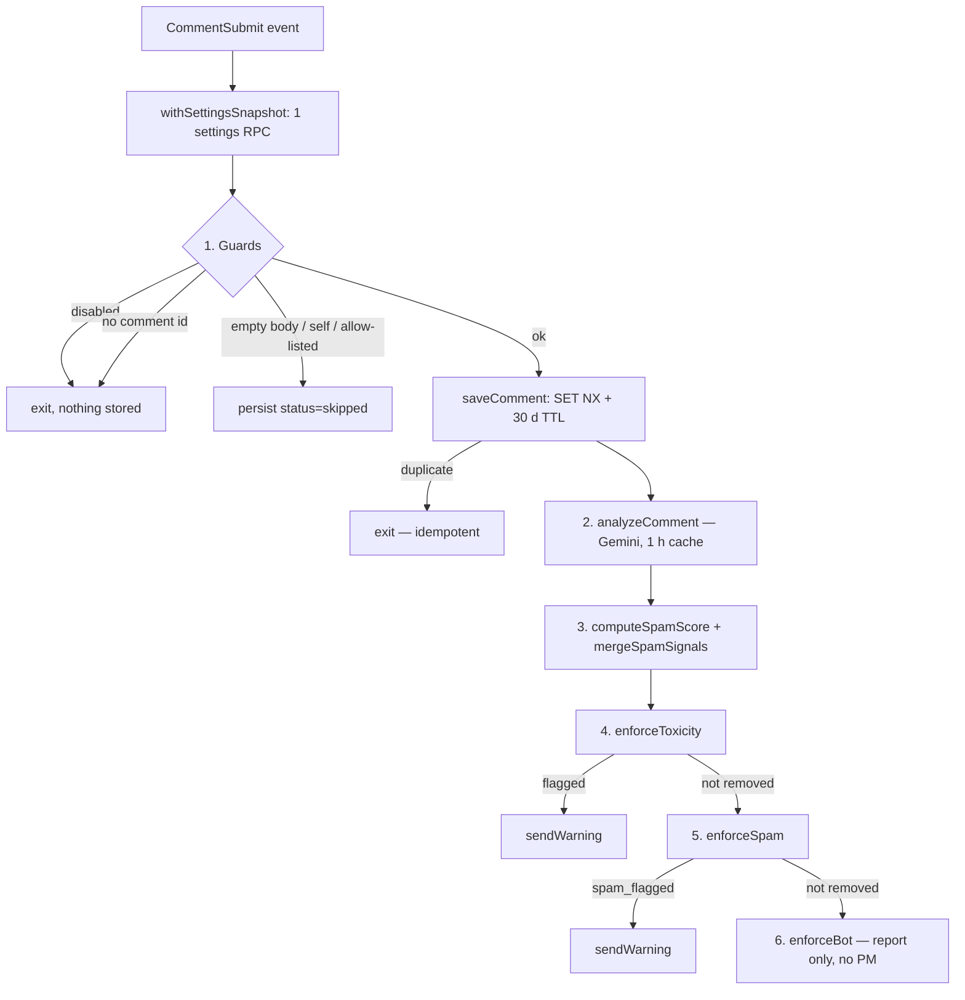

# Botditor — Architecture & Current State

> Verified against the code on 2026-10-18 (v1.5.0, including the 2026-10-18 audit changes on top of `eb4822b`).
> Keep this file in sync when behaviour changes. Planned work lives in [BACKLOG.md](./BACKLOG.md).

---

## 1. Purpose

Botditor is a Reddit [Devvit](https://developers.reddit.com) moderation app. It scores every new comment in a subreddit with Google Gemini for toxicity, spam, bot-likelihood and sentiment. It adds fast rule-based spam heuristics, then removes, reports, or ignores the comment according to moderator-configured thresholds. It also gives moderators menu actions to bulk-remove comment trees, ban authors, and manage an allow-list. A separate offline benchmark (`bench/`) compares Gemini with TypeSafe Jev on a local corpus. It never runs inside the app (§9).

Design goals visible in the code:

- **Fail safe.** Every stage catches its own errors. An AI failure produces all-zero scores, which never trigger an action, and thresholds are range-checked (> 0), so that holds even when settings are misconfigured. The flip side: a misconfigured AI silently turns moderation off instead of failing loudly. That's how the retired-model bug (OPS-1) and PR #18's broken Jev contract (AI-1) went unnoticed.
- **Idempotent.** Event re-deliveries are absorbed by Redis dedup keys at every side-effecting step, and the record write itself is an atomic `SET NX`.
- **Bounded.** Every per-comment Redis key expires (§8).
- **Tunable without redeploys.** All thresholds and toggles are Devvit settings, and a dry-run mode logs decisions without acting.

---

## 2. Platform and stack

| Layer | Technology | Notes |
|---|---|---|
| Platform | Devvit `@devvit/public-api` **0.12.20** | Legacy "Blocks-era" singleton API (`Devvit.addTrigger/addMenuItem/createForm`). Deprecated since Devvit 0.13.0 in favour of Devvit Web; see [PLAT-1](./BACKLOG.md#p2--platform). Latest Devvit is **0.14.8** (2026-10-16). |
| Runtime | Node.js on Reddit's servers | Local dev needs Node **22.2+**; 24.x recommended. |
| AI | Google Gemini REST API (`generateContent`) | The only provider the app calls. Called with the global `fetch` that Devvit polyfills over its HTTP plugin. |
| Benchmark (offline) | TypeSafe Jev, System One API (`POST /v1/systemone`) | `npm run bench` on a developer machine only (`tsx bench/run.ts`). Not bundled, not a declared fetch domain ([POL-3](./BACKLOG.md)). |
| Storage | Devvit Redis | Scoped per installation (per subreddit). Limits: 5 GB storage, 40k commands/s, 5 MB/request. |
| Language | TypeScript 6.0 | `tsconfig.json` extends `@devvit/public-api/devvit.tsconfig.json` (strict, `NodeNext`). |
| Tests | Vitest 4.1 | Hand-written `vi.fn()` mocks of the Devvit context, kept in line with the real API return values. `@devvit/test` is installed but unused ([TOOL-2](./BACKLOG.md)). |
| CLI | `devvit` **0.12.20**, pinned devDependency | Fixed in TOOL-1. `npm install` provides the CLI, and the npm scripts use it. |
| CI | GitHub Actions (`.github/workflows/ci.yml`) | `npm ci` → `type-check` → `test` on pushes to `main` and on PRs. |
| Scripts | `tsx` 4.23 | Runs the TypeScript benchmark in Node (the sources import `./x.js`, which plain Node can't map to `.ts`). |

---

## 3. Source layout

```
src/
├── main.ts              Entry point: Devvit.configure (http domains), CommentSubmit trigger, menu items, forms
├── settings.ts          Devvit.addSettings — every installation and app setting, plus onValidate validators
├── types.ts             Shared types, SETTINGS names, REDIS_KEYS builders, constants (models, timeouts, TTLs)
├── commentIngestion.ts  CommentSubmit handler — guards, persistence, orchestrates the pipeline
├── settingsSnapshot.ts  Wraps the context so a trigger makes one settings RPC (PERF-1)
├── commentStorage.ts    Redis persistence of IngestedComment records (atomic write, TTL, index trim, counter)
├── allowlist.ts         User allow-list (Redis keys + settings list, self-allowlist, fail-open)
├── ai.ts                Gemini analysis with 1 h cache; context-free requestGeminiAnalysis() shared with bench/
├── jev.ts               TypeSafe Jev System One client (context-free). Imported only by bench/, never bundled
├── spam.ts              Rule-based spam heuristics + mergeSpamSignals() rule/AI blend
├── rules.ts             Loads + validates moderation settings into a ModerationRules snapshot
├── moderation.ts        Toxicity / spam / bot enforcement: remove (+ removal note), report, dry-run, dedup
├── warnings.ts          Warning PMs with per-profile templates and 48 h cooldown
├── bans.ts              "Ban User" form handler: permission check, ban with audit note, analytics record
├── nuke.ts              "Mop" handlers — remove/lock a comment tree or all comments on a post
└── __tests__/           Vitest unit tests + pipeline tests (main.ts: fetch-domain guard only; nuke.ts untested)
bench/
├── benchmark.ts         Pure logic: corpus parsing, runner (concurrency-limited, per-provider timing), summary, report
├── run.ts               CLI for `npm run bench`: env keys → both providers → report + bench/results/<ts>.json
├── corpus.example.jsonl Synthetic, labelled example corpus
└── __tests__/           Benchmark unit tests (no network)
```

Each module that performs side effects exposes a public wrapper that catches everything and an `…Inner` function with the logic, e.g. `analyzeCommentWithGemini` / `analyzeCommentInner`.

---

## 4. Comment pipeline

`Devvit.addTrigger({ event: "CommentSubmit" })` → `handleCommentSubmit()` in `commentIngestion.ts`:



Step by step:

```
CommentSubmit event
 0. withSettingsSnapshot(context) — all settings.get() calls share one getAll() RPC
 1. botditorEnabled == false ────────────────────────────► exit (nothing stored)
    loadModerationRules() + logActiveRules()
    missing comment id ──────────────────────────────────► exit
    empty body ──────────────► persist status=skipped (deleted | missing_body)
    author == app account ───► persist status=skipped (self_comment)
    author allow-listed ─────► persist status=skipped (allowlisted)
    saveComment() — SET NX fails ───────────────────────► exit (idempotent)
    status=processing
 2. analyzeComment()        Gemini (§9). Emoji-only shortcut, 1 h cache, zero-score fallback
 3. computeSpamScore()      rule heuristics
    mergeSpamSignals()      rule ≥ 0.5 or blocked domain → rule result; else max(rule, AI). Stored AND enforced
    status=analyzed, analysis saved
 4. enforceToxicity()       remove ≥ removeThreshold │ report ≥ flagThreshold │ none
      └─ "flagged" → sendWarning()
 5. enforceSpam()           (skipped if step 4 removed) uses the merged spam result
      └─ "spam_flagged" → sendWarning()
 6. enforceBot()            (skipped if 4 or 5 removed) report ≥ botFlagThreshold; no warning PM
```

Notes:

- **Author identity (COR-1).** `authorName = event.author?.name || event.comment.author`. `comment.author` can be the author's `t2_…` ID; `event.author.name` (`UserV2.name`) is the username that the allow-list, the new-account heuristic, warning cooldowns and PMs need. `warnings.ts` still re-fetches the comment before PMing, as a belt-and-braces measure. Not yet verified in a live playtest.
- `moderationAction` on the stored record is overwritten by each later step, so it holds the *last* action (e.g. `warned`, `bot_flagged`), not the full history.
- Toxicity, spam and bot reports share the `flagged:<commentId>` dedup key, so a comment gets at most one Botditor report.
- `saveComment()` runs outside the pipeline's `try`. If Redis rejects the write, the error escapes to the trigger's top-level catch in `main.ts` and the comment isn't analysed. With TTLs (§8) the quota is no longer expected to fill.

---

## 5. Moderation decision rules

| Signal | Condition | Action (live) | Action (dry-run) |
|---|---|---|---|
| Toxicity (Gemini) | `score ≥ toxicityRemoveThreshold` | `comment.remove()` + removal note `[botditor] <reason>` → `removed` | `dry_run_remove` |
| Toxicity (Gemini) | `score ≥ toxicityFlagThreshold` | `reddit.report()` with `[botditor] toxicity=<score> — <reason>` → `flagged`, then warning PM | `dry_run_flag` |
| Spam (merged) | URL on blocked-domain list | remove, regardless of `spamMode` → `spam_removed` | `dry_run_spam_remove` |
| Spam (merged) | `spamMode == "remove"` and `score ≥ spamRemoveThreshold` | remove → `spam_removed` | `dry_run_spam_remove` |
| Spam (merged) | `score ≥ spamFlagThreshold` | report `[botditor] spam=<score> — <reasons>` → `spam_flagged`, then warning PM | `dry_run_spam_flag` |
| Bot-likelihood (Gemini) | `score ≥ botFlagThreshold` | report `[botditor] bot-likelihood=<score> — <reason>` → `bot_flagged`. **No removal, no ban, no PM.** | `dry_run_bot_flag` |

**Spam blend (`mergeSpamSignals`, COR-3).** A rule-based score ≥ 0.5 (or a blocked domain) is final. Otherwise the enforced score is `max(rule, AI)`, and when the AI wins its reason is appended (`AI spam score 0.7: …`). Because AI failures return 0, they never raise the score.

**Threshold validation (`rules.ts`, COR-2).**

1. *Range.* An unset, non-numeric, or ≤ 0 value falls back to the default with a warning, because a `0` would act on every comment, including AI failures. Values > 1 are kept (the action never fires) but logged. The settings form (`onValidate` in `settings.ts`) rejects anything outside (0, 1] at save time.
2. *Ordering.* If a remove threshold is lower than its flag threshold, the flag threshold is clamped down to it.
3. *Enums.* `spamMode` and `moderationProfile` are normalised (trim and lowercase). Unknown values fall back to `flag` and `chill`, and the form rejects them.

Rule-based spam heuristics (`spam.ts`), summed and clamped to 0–1:

| Heuristic | Delta |
|---|---|
| > 3 URLs whose domain isn't allow-listed | +0.4 |
| Same author posted an identical body within 10 min (DJB2 hash in Redis) | +0.5 |
| Account age < 3 days **and** karma < 10 | +0.3 |
| Any URL on the blocked-domain list | score = 1.0, `blockedDomain = true` |

Reddit's report-reason and removal-note fields have a 100-character limit, so `truncateReason()` clips strings at those API boundaries only.

**Moderation profiles (Story 15).** `moderationProfile` selects the warning template only. Threshold presets aren't implemented, because Devvit returns each threshold's registered `defaultValue` when it's unset, so the code can't tell "the moderator chose 0.85" from "untouched". A preset would either override moderators' explicit values or never apply. See [story 15](./story-15-moderation-styles.md).

---

## 6. Moderator actions (menu items)

All are `forUserType: "moderator"`.

| Location | Label | Behaviour |
|---|---|---|
| comment | Add author to allowlist | Sets `allowlist:user:<name>`. |
| comment | Remove author from allowlist | Deletes that key. The settings-based list isn't touched. |
| comment | Mop comments | Form (remove / lock / skip distinguished). Needs mod permission `all` or `posts`. Removes the comment and every descendant, then adds a removal note `[botditor] mopped by u/<mod> (comment thread)` to every removed comment (batches of 100 IDs). |
| post | Mop post comments | Same as above for every comment on the post (`… (all comments on post)`). |
| comment | Ban User | Form pre-filled with the author and the stored AI reason. Needs `all` or `access`. Calls `reddit.banUser()` (field mapping below) and stores an analytics record. |

Mop and Ban run as the **app account**, so Reddit's native mod log attributes them to the app. Botditor therefore records the human moderator itself, in removal notes (Mop) and in the ban `note` (Ban).

`banUser` field mapping (OPS-3):

| Form field | `banUser` option | Who sees it | Limit |
|---|---|---|---|
| Ban reason (pre-filled from AI) | `reason` | Moderators (Banned Users list) | 100 chars (truncated) |
| Message to the banned user | `message` | The banned user | — |
| Duration | `duration` | — | 0 = permanent, otherwise 1–999 days (validated) |
| Mod note | `note` = `Banned by u/<mod> via botditor[: <note>]` | Moderators (mod log) | 300 chars (truncated) |
| *(the comment)* | `context` = comment ID | Moderators | — |

---

## 7. Configuration reference

Installation settings are edited per subreddit at `https://developers.reddit.com/r/<subreddit>/apps/<app-slug>`. App settings are set by the developer with `devvit settings set <name>`.

| Setting (`SETTINGS.*` key) | Scope | Type | Default | Validated | Enforced? |
|---|---|---|---|---|---|
| `botditorEnabled` | installation | boolean | `true` | — | ✅ |
| `allowlistUsernames` | installation | string (CSV) | `""` | — | ✅ |
| `allowlistDomains` | installation | string (CSV) | `""` | — | ✅ URL-count heuristic only |
| `toxicityRemoveThreshold` | installation | number | `0.85` | (0, 1] | ✅ |
| `toxicityFlagThreshold` | installation | number | `0.60` | (0, 1] | ✅ |
| `dryRunMode` | installation | boolean | `false` | — | ✅ |
| `spamRemoveThreshold` | installation | number | `0.80` | (0, 1] | ✅ only when `spamMode = remove` |
| `spamFlagThreshold` | installation | number | `0.50` | (0, 1] | ✅ |
| `spamMode` | installation | string | `flag` | form + runtime (`flag` / `remove`) | ✅ |
| `spamBlockedDomains` | installation | string (CSV) | `""` | — | ✅ |
| `botFlagThreshold` | installation | number | `0.75` | (0, 1] | ✅ report-only (Story 05) |
| `moderationProfile` | installation | string | `chill` | form + runtime (`chill` / `strict`) | ⚠️ selects the warning template only (Story 15) |
| `warningTemplateStrict` | installation | paragraph | formal template | — | ✅ |
| `warningTemplateChill` | installation | paragraph | friendly template | — | ✅ |
| `geminiApiKey` | app (secret) | string | — | — | ✅ required for Gemini scoring |
| `geminiModel` | app | string | `gemini-3.6-flash` | — | ✅ |

The `aiProvider`, `jevApiKey`, `jevApiHost` and `jevModel` settings from PR #18 were removed on 2026-10-18 (POL-3). Values that installs already saved are simply never read. Benchmark keys come from environment variables instead (§9).

Devvit returns a setting's registered `defaultValue` whenever it hasn't been set, so defaults in `settings.ts` take effect everywhere and hard-coded fallbacks elsewhere never run. A setting's *type* can't be changed safely in place (e.g. `string` → `select`, whose value is `string[]`). That's why the enum settings stay free text with validators instead of becoming `select` fields.

---

## 8. Redis data model

All keys are built by `REDIS_KEYS` in `types.ts`. Devvit Redis is namespaced per installation, with no `KEYS`/`SCAN`, so anything that needs aggregate queries needs its own counters or indexes (ANL-0).

| Key | Value | TTL | Written by | Read by |
|---|---|---|---|---|
| `comment:<commentId>` | `IngestedComment` JSON (body ≤ 4000 chars) | **30 d** from ingestion (`COMMENT_TTL_S`); status updates re-apply it | commentStorage (`SET NX`) | ingestion, Ban User pre-fill |
| `comments:index:<sub>` | sorted set, score = ingestion ms | entries **> 30 d trimmed** on every save (`zRemRangeByScore`) | commentStorage | `listCommentIds()` (not called by the app yet) |
| `comments:count:<sub>` | integer | none (one key per sub) | commentStorage | `getCommentCount()` (not called yet) |
| `allowlist:user:<name>` | `"1"` | none (intentional; moderator-managed) | allow-list menu items | allowlist |
| `analysis:cache:<commentId>` | Gemini `AnalysisResult` JSON | 1 h | ai | ai |
| `spam:recentbody:<author>:<hash>` | `"1"` | 10 min | spam | spam |
| `removed:<commentId>` | `"1"` | **7 d** (`REMOVED_DEDUP_TTL_S`) | moderation | moderation (dedup) |
| `flagged:<commentId>` | `{ score, reason, timestamp }` | 24 h | moderation (tox / spam / bot) | moderation (dedup) |
| `warned:<author>` | `{ commentId, issue, profile, timestamp }` | 48 h | warnings | warnings (cooldown) |
| `ban:<username>:<epochMs>` | ban record JSON | none | bans | nothing yet (Story 14) |
| `bans:count:<sub>` | integer | none | bans | nothing yet (Story 14) |

PR #18's `analysis:cache:jev:*` and `bench:jev_vs_gemini:*` keys are no longer written. Any that exist will expire on their own, within 1 h and 7 d respectively. Benchmark results now live in local files (`bench/results/`), not Redis.

Retention rationale (COR-4): everything that grows **per comment** now expires. The remaining TTL-less keys grow per moderator action (allow-list entries, bans) and are negligible against the 5 GB quota. Ban records are kept for future ban analytics; add a TTL if that changes. The 24 h `flagged:` records are dedup keys and can't back weekly statistics. That's ANL-0.

**Proposed ANL-0 schema (not implemented).** Increment date-keyed counters at action time, so Stories 13/14/20/21 read O(days) keys instead of scanning:

```
stats:daily:<YYYY-MM-DD>            hash  { ingested, removed, flagged, spam_removed, spam_flagged, bot_flagged, warned, banned }  TTL 400 d
stats:daily:<YYYY-MM-DD>:users      zset  member=<author>, score=actions that day                                                TTL 35 d
```

---

## 9. External services

### Provider policy

The app calls **only Google Gemini**. Devvit's fetch policy says *"Only OpenAI and Google Gemini are currently permitted as AI providers. Requests for any other AI services will be denied."* Domain requests are reviewed for **playtests as well as uploads**, so a non-approved AI domain can't be reached from Reddit's servers at all. PR #18's in-app `jev`/`dual_run` modes were therefore removed on 2026-10-18 (POL-3, option *b*). TypeSafe Jev is compared offline instead (below).

### Google Gemini

| Aspect | Behaviour |
|---|---|
| Endpoint | `POST https://generativelanguage.googleapis.com/v1beta/models/<model>:generateContent` (host in `GEMINI_API_HOST`) |
| Auth | `geminiApiKey` app secret in the `x-goog-api-key` header |
| Model | `geminiModel`, default **`gemini-3.6-flash`** (`DEFAULT_GEMINI_MODEL`, shared by `settings.ts` and `ai.ts`). The previous default, `gemini-1.5-flash`, was shut down on 2025-09-29 (OPS-1). |
| Prompt | Instructions in `systemInstruction`. The user turn is only the comment, wrapped in `<comment>…</comment>` with any such tags stripped. Body capped at 8000 chars. Reduces prompt injection; doesn't eliminate it. |
| Generation config | `responseMimeType: "application/json"`, `maxOutputTokens: 2048`. Gemini 3+: `thinkingLevel: "LOW"` and default temperature. Older models: `temperature: 0.1`, no `thinkingLevel`. |
| Output | JSON; code fences stripped defensively, fields validated, scores clamped to 0–1. |
| Timeout | 10 s (`GEMINI_TIMEOUT_MS`) via `Promise.race`, because Devvit's fetch ignores `AbortSignal`. Devvit's own cap is 30 s. |
| Caching | `analysis:cache:<id>`, 1 h. Failures (`isGeminiFailure()`) aren't cached. |
| Code shape | `analyzeComment()` adds the emoji shortcut, settings and Redis cache around the context-free `requestGeminiAnalysis(body, { apiKey, model }, label)`, which the benchmark reuses so both measure the same request. |
| Data sent | Comment text only. |

Fallback `reason` values (all zero scores): `no api key configured`, `timeout`, `fetch error`, `api error <status>`, `response read error`, `empty response`, `parse error`, `unexpected error`.

### TypeSafe Jev (System One) — offline benchmark only

`src/jev.ts` is a context-free client, imported only by `bench/` and verified absent from an esbuild bundle of `main.ts`. PR #18's original client POSTed `{ model, target, state, decision_schema }` to `/v1/decide`, which isn't part of TypeSafe's API. It was rebuilt on 2026-10-18 against the documented contract (AI-1).

| Aspect | Behaviour (per [docs.typesafe.ai/api](https://docs.typesafe.ai/api)) |
|---|---|
| Endpoint | `POST https://api.typesafe.ai/v1/systemone` (`JEV_API_PATH`; host overridable in `JevConfig`) |
| Auth | `Authorization: Bearer <JEV_API_KEY>` (environment variable, never a Devvit setting) |
| Model | `JEV_MODEL` env var, default **`jev-1.13.0`** (pinned; `jev-latest` is an alias that moves between releases) |
| Request | `{ model, state: { comment: { text, subreddit } }, questions }`. `JEV_QUESTIONS`: `toxic`, `spam`, `bot` (type `noul`, each with true/false criteria) and `sentiment` (type `choice`: positive / neutral / negative). |
| Response | `answers.<id>.noul` (probability 0–1) → `toxicityScore` / `spamScore` / `botLikelihood`. `answers.sentiment.choice` → `sentiment`. Any missing or mistyped answer → `parse error`. |
| Reason | Jev doesn't generate text. `composeReason()` names the strongest signal ≥ 0.5, or returns `no policy concern detected`. |
| Timeout | 3 s (`JEV_TIMEOUT_MS`) |
| Data sent | Comment text (≤ 8000 chars) and subreddit name. No usernames or IDs. |

### Offline benchmark (`npm run bench`)

`dotenv -e .env -- tsx bench/run.ts [corpus.jsonl] [--concurrency N] [--out dir]`

- **Input.** A JSONL corpus: `{ id, text, subreddit?, expected?: { toxic?, spam?, bot? } }`. The parser rejects bad lines with their line number. `bench/corpus.example.jsonl` is synthetic.
- **Run.** Each item's Gemini and Jev calls run in parallel and are timed separately. At most `concurrency` items (default 2) are in flight.
- **Summary**, under `DEFAULT_RULES`:
  - latency (ok/failed, mean, p50, p95) per provider,
  - mean |Δ| per score,
  - agreement on the toxicity action (remove/flag/none), the spam and bot flags, and sentiment,
  - precision and recall per labelled signal at the flag threshold.
- **Exclusions.** Failed calls (`isGeminiFailure` / `isJevFailure`) are left out of deltas and agreement, and counted per provider.
- **Output.** A terminal report, plus `bench/results/<timestamp>.json` (git-ignored) with the corpus path, models, rules, summary and every row.
- **Scope.** Compares AI scores only. The rule-based spam heuristics need Reddit and Redis, and they're identical for both providers.

### Devvit HTTP fetch policy

- Apps must request every domain they fetch, **even globally allow-listed ones**. `main.ts` declares only `generativelanguage.googleapis.com`. `main.test.ts` fails if `api.typesafe.ai` is ever added.
- **Only OpenAI and Google Gemini are permitted AI providers. Requests for any other AI services are denied** (Devvit HTTP fetch policy). Domain requests are submitted during playtest and upload alike.
- An app that uses fetch needs Terms and Privacy Policy links in its app details, and a "Fetch Domains" section in its README with each domain's justification.
- Devvit's fetch polyfill ignores `AbortSignal`, so timeouts need `Promise.race`.

---

## 10. Error-handling conventions and platform notes

- Every stage returns a safe value (`"none"`, fallback scores, `{ success: false }`) instead of throwing. Errors are logged with a `[module]` prefix.
- Redis read failures in dedup/cooldown checks **fail open** (the action proceeds). Allow-list read failures also fail open (analysis proceeds).
- **`context.modLog` no longer exists** (removed between Devvit 0.12.0 and 0.12.14). Fixed by OPS-3: auto-removals use `comment.addRemovalNote({ reasonId: "", modNote })`, Mop uses `reddit.addRemovalNote({ itemIds, reasonId: "", modNote })`, and bans record the acting moderator in `banUser({ note, context })`. `reasonId: ""` means no subreddit removal reason (which would message the user) is attached. The note is mod-facing only.
- `settings.get()` in Devvit 0.12 is `getAll()[name]`, a full plugin RPC each time. `withSettingsSnapshot()` makes it one RPC per trigger. It layers the context with `Object.create`, because the Devvit context is an object literal with lazy getters (`ui`, `useState`, …) that throw outside Blocks, so it must never be spread.

---

## 11. Development workflow

```sh
npm install          # also installs the pinned devvit CLI 0.12.20
npm test             # vitest run — src/**/*.test.ts (vitest.config.ts)
npm run type-check   # tsc --noEmit
npm run dev          # devvit playtest (loads .env via dotenv-cli)
npm run deploy       # devvit upload
npm run launch       # devvit publish (submits for review)
npm run bench        # offline Gemini-vs-Jev benchmark (needs GEMINI_API_KEY + JEV_API_KEY)
```

Tooling notes:

1. **Stale build output shadows source**, fixed by OPS-2. `tsc --build` used to write a `.js` next to every `.ts`, and the Devvit bundler and Vitest resolved `./ai.js` to it. `type-check` is `tsc --noEmit`. **If you ever run plain `tsc`, delete its output from `src/`.**
2. **The `devvit` devDependency** was `1.0.0`, an empty 202-byte placeholder that Dependabot "upgraded" to (commit `c9a3315`). It's now pinned to `0.12.20` (TOOL-1). The CLI pulls in a large dev-only dependency tree: `npm audit` shows 70 advisories in total. Only 8 are in the runtime tree, all transitive from `@devvit/public-api` 0.12.20; the rest come from dev tooling. Re-pin the CLI whenever `@devvit/public-api` changes, and don't accept Dependabot bumps to `devvit@1.x`.
3. **Versions.** `package.json` and `devvit.yaml` both read `1.5.0`. `devvit upload` can bump `devvit.yaml` on its own; keep `package.json` in step, and never lower `devvit.yaml` (uploads must increase).

Testing conventions: each test file builds its own mock context. Mocks follow the real API's return values: Redis `set(…, { nx: true })` returns `""` when the key exists, `settings.getAll()` is provided, and no mock stands in for an API Devvit no longer has. Pipeline tests in `commentIngestion.test.ts` run the whole handler with a mocked `fetch`. `main.test.ts` loads `main.ts` with Devvit's registration calls stubbed, to check the fetch domains. Benchmark tests use injected providers and a fake clock (no network). Suite: 14 files, 299 tests. `nuke.ts` is untested.

---

## 12. Known limitations (summary)

See [BACKLOG.md](./BACKLOG.md) for owners, priorities, and fixes.

| Area | Limitation |
|---|---|
| Policy | Privacy policy and app-details links still need doing (POL-2). |
| AI | The Gemini path needs one live playtest with a real key, and the Jev client one real `npm run bench` run. Prompt injection is mitigated, not impossible. |
| Correctness | COR-1 author resolution and the `SET NX` duplicate semantics are coded and tested against mocks but not yet confirmed in a playtest. |
| Features | Profiles don't set thresholds (15, by design for now). Posts aren't analysed (19). No stats or summaries (11–14, 16, 20; ANL-0 first). Bot detection uses the AI signal only; behavioural heuristics are pending. |
| Safety | Warning PMs go out on *flag*, before any human review (POL-1). |
| Testing | No `@devvit/test` integration test (TOOL-2); `nuke.ts` is untested. |
| Platform | Built on the deprecated `@devvit/public-api` menu/form model (PLAT-1). |
